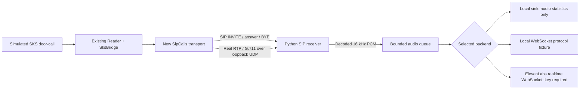

# Local SIP transcription server

Implemented and tested on this Mac on **23 October 2026**. The server receives a real SIP call, accepts it, decodes RTP/G.711 audio and supplies 16 kHz mono PCM to a realtime transcription backend. Python drives PJSIP 2.17 through PJSUA2; no Asterisk or FreeSWITCH process is needed for this test.



## What is verified

- The existing `Reader`, `SksBridge` and simulated SKS state machine drive the call; answering SIP enables the emulator's audio, and hanging up disables it.
- Two separate processes exchange actual SIP and RTP via PJSIP. SDP negotiation, G.711 encoding/decoding and resampling are exercised.
- Received PCM preserves a generated 440 Hz tone. Tests verify its frequency and level, and compare the diagnostic WAV bytes with the audio delivered over WebSocket.
- A second test sends locally generated speech from macOS `say` through the same path. Neither test opens a microphone or speaker.
- Repeated calls, server-side hangup, visitor departure, call timeout, rejected SIP/HTTP credentials, a busy receiver, backend rejection/disconnection, final-transcript timeout and subsequent-call recovery are tested.
- The local ElevenLabs fixture verifies the WebSocket request, base64 PCM, sample rate and final commit, and sends explicit `[FIXTURE]` partial/final responses.
- The existing 47 emulator tests still pass. Seven additional tests cover the SIP/streaming work.

**Actual ElevenLabs speech recognition has not been tested.** Fixture text is predetermined and is not a recognition result. Alex requested local testing first and will provide a key later.

**The office UDM is not in this test's path.** The new `SipCalls` replaces `LabCalls` in an isolated simulator instance. It does not change `NativeCalls` or configure Access's third-party SIP settings. The adopted reader's native `/third_party_sip_call` RPC remains unimplemented. This proves the new receiver/media bridge works with our emulator's new SIP transport, not that the office controller already routes calls to it.

## Run it now

Run commands from `outputs/unifi-access-poc` using its existing `.venv`. The locally built PJSUA2 binding is already installed on this Mac.

Terminal 1 — receiver with no external service:

```sh
.venv/bin/python sip_transcription.py --backend local
```

Terminal 2 — existing reader/SKS simulator using the new SIP transport:

```sh
.venv/bin/python sip_lab.py
```

Terminal 3 — trigger a call and inspect/end it:

```sh
.venv/bin/python poc.py ring --state .state-sip-reader/reader
.venv/bin/python poc.py status --state .state-sip-reader/reader
.venv/bin/python poc.py hangup --state .state-sip-reader/reader
```

The default source is a generated tone. For a generated speech file:

```sh
say -v Samantha -o /tmp/intercom-test.wav --file-format=WAVE --data-format=LEI16@48000 \
  'Hello. This is a local intercom audio test. Please leave the door closed.'
.venv/bin/python sip_lab.py --wav /tmp/intercom-test.wav
```

Use that `sip_lab.py` command instead of starting a second simulator. WAV input must be mono 48 kHz signed 16-bit PCM, at most 60 seconds. It plays once per call, then sends silence. No sound is played through the Mac's speakers.

Both programs default to a ten-minute run limit. Calls have a 120-second maximum; `--call-seconds` changes the receiver limit. Ctrl-C closes calls, media and sockets. Do not reuse a state directory concurrently.

## Add ElevenLabs later

Put the key in a local file with permissions `0600`, or supply `ELEVENLABS_API_KEY` in the receiver's environment. Do not put it in a command argument, source file or handoff. Restart only the receiver with:

```sh
.venv/bin/python sip_transcription.py --backend elevenlabs --api-key-file /absolute/path/to/private-key-file
```

Then restart the simulator so it reads the receiver's new private connection file, and ring again. Selecting this backend sends the call audio to ElevenLabs and may incur usage charges. The default `local` backend never contacts ElevenLabs, even if the environment contains a key.

The implementation uses `scribe_v2_realtime`, `pcm_16000`, VAD segment commits and an explicit final commit on hangup. Partial and committed transcripts are visible in the authenticated status response. API/protocol errors end the call; there is no silent fallback pretending recognition succeeded. This implements the [official ElevenLabs realtime protocol](https://elevenlabs.io/docs/api-reference/speech-to-text/v-1-speech-to-text-realtime), but needs a live-key test before calling the integration verified.

## Control API and storage

The receiver writes `.state-sip-server/connection.json` (mode `0600`), containing its random loopback SIP port, HTTP URL and per-run bearer token. It removes this file on normal shutdown. The simulator reads it without printing credentials.

- `GET /status` — active call, last 20 completed calls, audio counters and bounded transcript history.
- `POST /hangup` with `{"call_id":"<current id from status>"}` — hang up only that call. A stale ID returns `409`.
- Every request requires `Authorization: Bearer <token>`.
- Last-run counters and transcripts are saved privately to `.state-sip-server/last-run.json`. Transcripts can contain conversation content; these files must remain private.
- No raw audio is saved by default. `--record` explicitly enables private 16 kHz WAV recordings for diagnostics.
- The simulator uses `.state-sip-reader/reader` and `.state-sip-reader/hub`; it refuses adopted state. Real office identities and the real door are untouched.

The SIP receiver accepts one call at a time. Audio queues hold at most two seconds; overflow fails the call instead of buffering an unbounded conversation. Partial/final transcript history is bounded to 100 events per call, with a size cap on each event.

## Scope before office deployment

This is deliberately a **loopback-only proof of concept**, not a LAN SIP PBX/registrar. Both signalling and RTP bind to `127.0.0.1`. The per-run `X-Intercom-Lab-Key` SIP header is a private lab credential, not standard SIP Digest authentication. The PJSIP build disables SIP TLS, physical sound devices and video. ElevenLabs HTTPS/WSS uses Python's normal certificate validation independently of that build.

Next deployment work is to implement the controller-requested SIP session in the adopted reader, choose registration/routing (a registrar/PBX or a suitable direct-call setup), and test it against the office Access configuration. LAN binding, normal SIP authentication, TLS/SRTP and network rules must be designed for that route; simply changing this program's bind address is not sufficient. Native UniFi EMS/WebRTC calls and this new SIP transport are separate paths today.

No DTMF unlock forwarding or real door output is implemented here. STT is informational only. Physical SKS communication remains a separate unfinished hardware task.

## Tests and dependency build

```sh
.venv/bin/python -m unittest discover -v
```

The five integration tests launch independent receiver and emulator processes and a loopback WebSocket fixture. They require PJSUA2; the generated-speech case uses macOS `/usr/bin/say` with the Samantha voice. All subprocesses are stopped and temporary recordings removed even after a failed assertion. The two smaller tests cover fixture/key restrictions and bounded callback queues.

PJSIP source: [official release 2.17](https://github.com/pjsip/pjproject/releases/tag/2.17), commit `5a457451fa2712ba18e12b01738e8ff3af2b26fd`. SWIG 4.5.1 and Python 3.14.8 were used here. No system-wide PJSIP was installed. To rebuild after setting up the project's normal `.venv` and dependencies:

```sh
brew install swig  # macOS, if missing
./build_sip_dependency.sh
```

The script downloads official PJSIP source into `../../work/pjproject-2.17`, checks the pinned commit, builds the loopback configuration and installs the Python binding into this project's virtual environment. The binding is compiled for the local machine; rebuild on a different architecture/Python version.

Implementation files: `sip_runtime.py` (PJSIP), `sip_calls.py` (emulator transport), `sip_lab.py` (lab entry point/WAV source), `sip_transcription.py` (receiver/control/lifecycle), `transcription.py` (backend transport), `test_sip_integration.py`, `test_transcription.py`.
